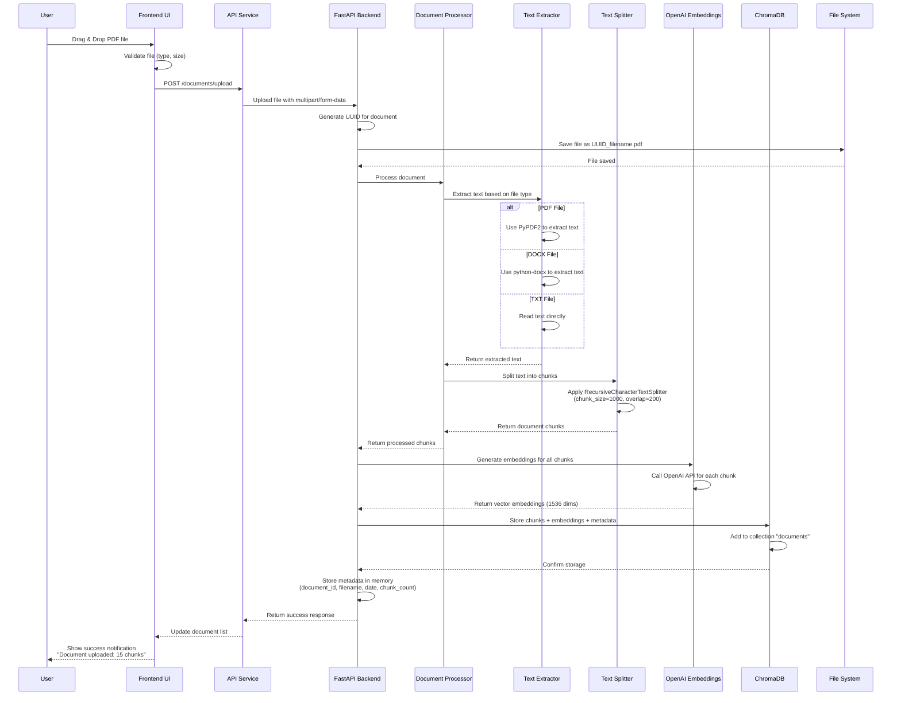
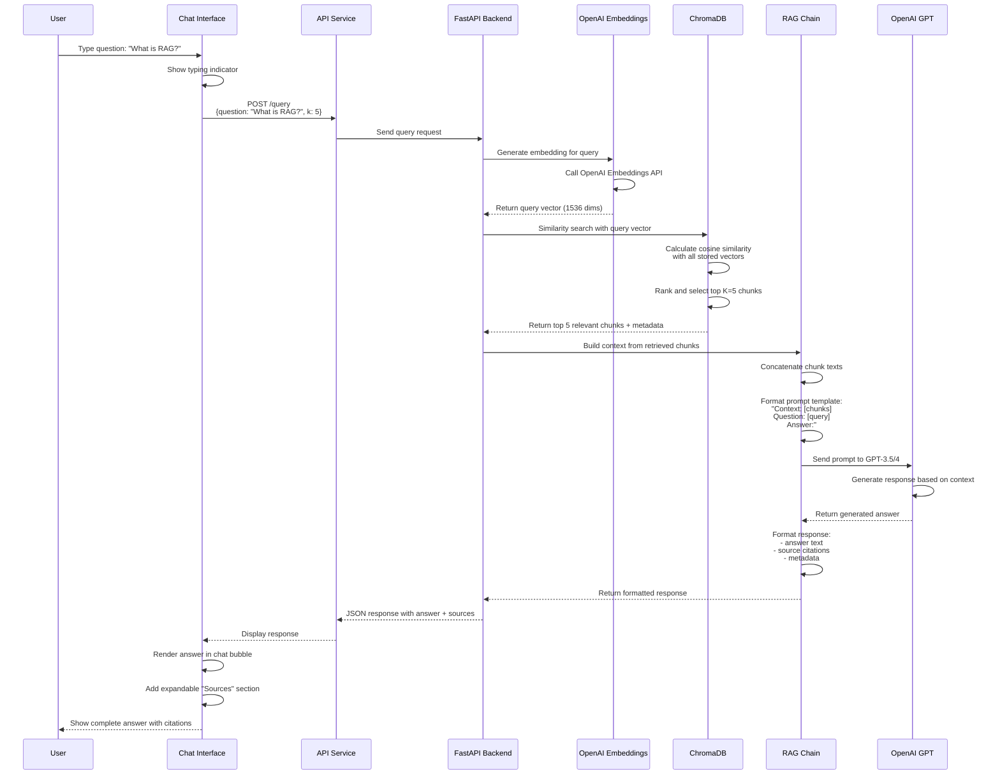
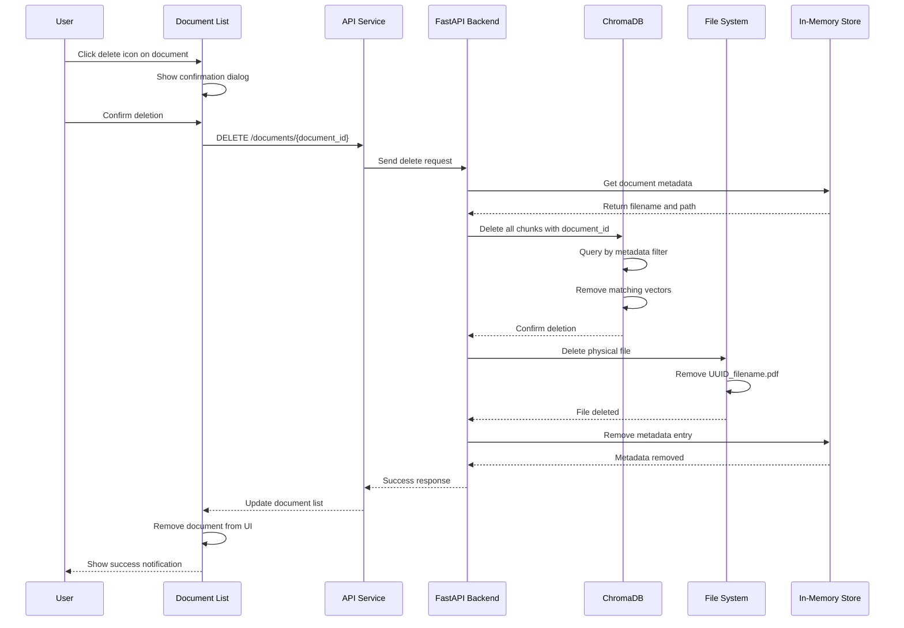
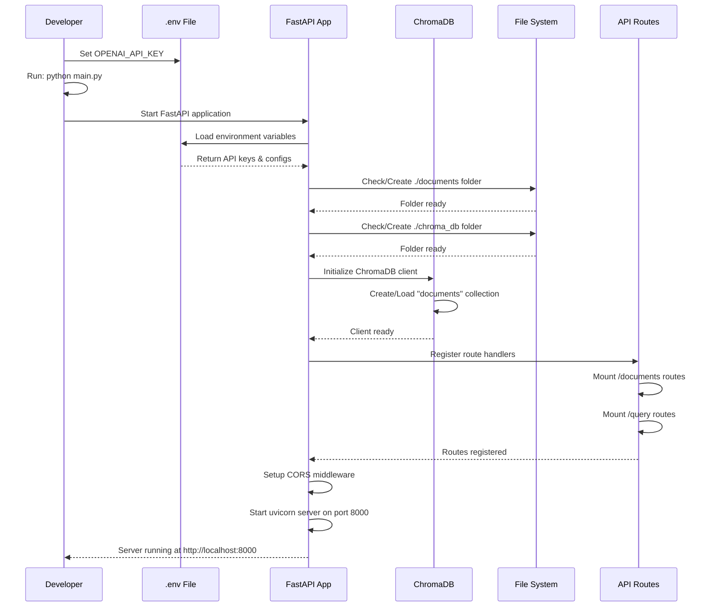
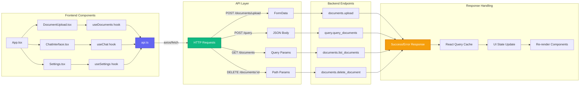
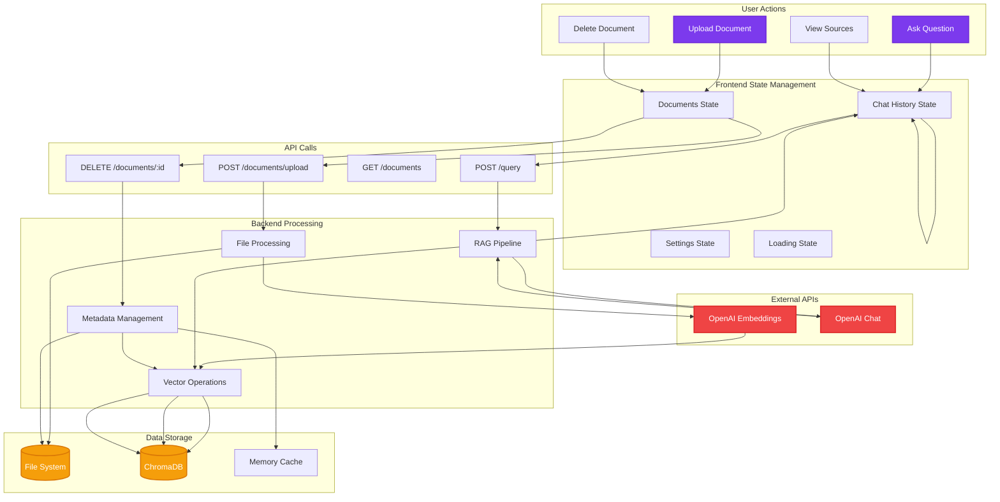

# RAG Application Detailed Flow Diagrams

## 1. Document Upload Flow



## 2. Query/Chat Flow



## 3. Document Delete Flow



## 4. Application Initialization Flow



## 5. Frontend-Backend Integration Flow



## 6. Data Flow Architecture



## 7. Component Hierarchy

```
RAG Application
│
├── Frontend (React/Loveable)
│   ├── App Component
│   │   ├── Layout
│   │   │   ├── Sidebar
│   │   │   │   ├── DocumentUpload
│   │   │   │   │   ├── FileDropzone
│   │   │   │   │   └── UploadProgress
│   │   │   │   ├── DocumentList
│   │   │   │   │   └── DocumentItem
│   │   │   │   └── ActionButtons
│   │   │   └── MainContent
│   │   │       ├── ChatHeader
│   │   │       ├── MessageList
│   │   │       │   ├── UserMessage
│   │   │       │   └── AIMessage
│   │   │       │       └── SourcesCitation
│   │   │       └── MessageInput
│   │   └── Modals
│   │       └── SettingsModal
│   ├── Hooks
│   │   ├── useDocuments
│   │   ├── useChat
│   │   └── useSettings
│   └── Services
│       └── api.ts
│
└── Backend (FastAPI)
    ├── main.py
    ├── app/
    │   ├── routes/
    │   │   ├── documents.py
    │   │   └── query.py
    │   ├── services/
    │   │   ├── document_processor.py
    │   │   ├── vector_store.py
    │   │   └── rag_chain.py
    │   ├── models/
    │   │   └── schemas.py
    │   └── config.py
    └── Storage
        ├── documents/ (File System)
        └── chroma_db/ (Vector Database)
```

## Key Technologies Used

### Frontend Stack:
- **React 18+**: UI framework
- **TypeScript**: Type safety
- **Tailwind CSS**: Styling
- **React Query**: API state management
- **Axios**: HTTP client
- **Lucide React**: Icons
- **Loveable**: AI-powered generation

### Backend Stack:
- **FastAPI**: Web framework
- **LangChain**: RAG orchestration
- **ChromaDB**: Vector database
- **OpenAI API**: Embeddings + LLM
- **PyPDF2**: PDF processing
- **python-docx**: Word processing
- **Pydantic**: Data validation

### Communication:
- **REST API**: HTTP/JSON
- **CORS**: Cross-origin requests
- **Multipart Form Data**: File uploads
- **WebSocket** (optional): Streaming responses

## Performance Considerations

1. **Chunking Strategy**: 1000 chars with 200 overlap
2. **Embedding Dimension**: 1536 (OpenAI)
3. **Similarity Search**: Cosine similarity
4. **Top K Results**: Default 5 chunks
5. **API Rate Limits**: Consider OpenAI limits
6. **Caching**: React Query for frontend
7. **Async Processing**: FastAPI async handlers


